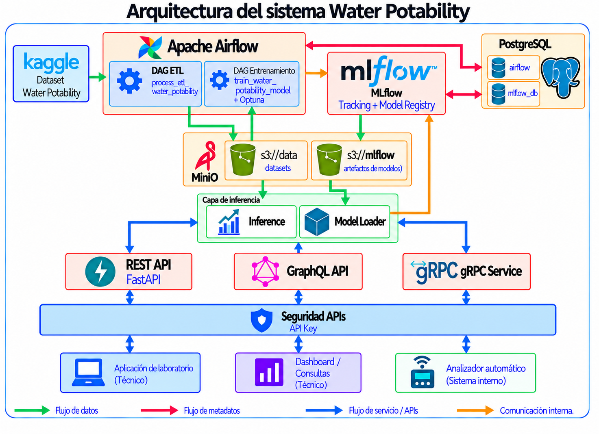

# Water Potability MLOps

Sistema MLOps para clasificación de potabilidad del agua, desde la ingesta y preparación de los datos hasta el entrenamiento, versionado y exposición del modelo mediante múltiples protocolos.

El proyecto permite determinar si una muestra de agua es potable a partir de sus características fisicoquímicas y expone el modelo productivo mediante REST, GraphQL y gRPC.

## Índice

- [1. Descripción del proyecto](#1-descripción-del-proyecto)
- [2. Arquitectura del sistema](#2-arquitectura-del-sistema)
- [3. Tecnologías utilizadas](#3-tecnologías-utilizadas)
- [4. Dataset y problema de clasificación](#4-dataset-y-problema-de-clasificación)
- [5. Pipeline de datos en Airflow](#5-pipeline-de-datos-en-airflow)
- [6. Entrenamiento y selección del modelo en Airflow](#6-entrenamiento-y-selección-del-modelo-en-airflow)
- [7. Gestión de experimentos con MLflow](#7-gestión-de-experimentos-con-mlflow)
- [8. Modelo productivo almacenado en MinIO](#8-modelo-productivo-almacenado-en-minio)
- [9. APIs de inferencia](#9-apis-de-inferencia)
- [10. Pruebas de las APIs](#10-pruebas-de-las-apis)
- [11. Instalación y ejecución](#11-instalación-y-ejecución)
- [12. Estructura del proyecto](#12-estructura-del-proyecto)
- [13. Conclusiones y posibles mejoras](#13-conclusiones-y-posibles-mejoras)

## 1. Descripción del proyecto

Water Potability MLOps es un sistema de machine learning orientado a la clasificación de muestras de agua según su potabilidad. A partir de un conjunto de características fisicoquímicas, el modelo determina si una muestra puede clasificarse como potable o no potable.

El proyecto implementa un flujo MLOps de punta a punta que contempla la preparación y almacenamiento de los datos, el entrenamiento y optimización de modelos, el seguimiento de experimentos, el versionado y selección del modelo productivo y su posterior exposición para inferencia.

El modelo seleccionado se publica mediante tres mecanismos de comunicación: una API REST desarrollada con FastAPI, una API GraphQL y un servicio gRPC que permite realizar predicciones mediante llamadas unary y server streaming.

La solución se ejecuta mediante contenedores Docker y los distintos servicios que componen el sistema se integran y administran utilizando Docker Compose.

## 2. Arquitectura del sistema

La solución se implementa como una arquitectura modular compuesta por servicios de orquestación, procesamiento de datos, entrenamiento, almacenamiento, seguimiento de experimentos, inferencia y despliegue en contenedores.



A grandes rasgos, los componentes son:

- **Apache Airflow**: orquesta los pipelines de datos y entrenamiento.
- **MinIO**: almacena datasets y artefactos.
- **MLflow**: gestiona el seguimiento de experimentos y el Model Registry.
- **PostgreSQL**: persiste los metadatos de Airflow y MLflow.
- **REST, GraphQL y gRPC**: son servicios de inferencia que realizan predicciones, reutilizan una capa común de inferencia y se encuentran protegidos mediante API Key.

## 3. Tecnologías utilizadas

El proyecto integra distintas tecnologías para cubrir el procesamiento de datos, entrenamiento, evaluación y gestión de modelos, almacenamiento, despliegue e inferencia. A saber:

| Tecnología | Uso en el proyecto |
|---|---|
| **Python** | Desarrollo de los pipelines, entrenamiento, inferencia y APIs. |
| **Apache Airflow** | Orquestación de los pipelines de procesamiento de datos y entrenamiento. |
| **MLflow** | Seguimiento de experimentos, registro de métricas y parámetros y gestión de versiones del modelo mediante Model Registry. |
| **Optuna** | Búsqueda y optimización de hiperparámetros. |
| **imbalanced-learn / SMOTE** | Balanceo de la clase minoritaria durante el entrenamiento. |
| **MinIO** | Almacenamiento compatible con S3 para datasets, información de preprocesamiento y artefactos de MLflow. |
| **PostgreSQL** | Backend de persistencia utilizado por Airflow y MLflow. |
| **Docker** | Contenerización de los distintos componentes del sistema. |
| **Docker Compose** | Orquestación de los servicios que conforman la infraestructura. |
| **FastAPI** | Exposición de la API REST de inferencia. |
| **Strawberry GraphQL** | Implementación de la API GraphQL. |
| **gRPC** | Comunicación de alto rendimiento para inferencia entre sistemas utilizando Protocol Buffers. |
| **uv** | Gestión del entorno Python y de las dependencias del proyecto. |
| **Git / GitHub** | Control de versiones y alojamiento del código fuente. |

## 4. Dataset y problema de clasificación

El proyecto utiliza el dataset **Water Potability**, disponible en [Kaggle]( https://www.kaggle.com/datasets/adityakadiwal/water-potability) (versión 3), que contiene mediciones fisicoquímicas de distintas muestras de agua. El objetivo es resolver un problema de **clasificación binaria**, determinando si una muestra de agua es potable o no potable.

La variable objetivo es `Potability`, cuyos valores representan:

- `0`: agua no potable.
- `1`: agua potable.

Para realizar la clasificación se utilizan las siguientes variables:

| Variable | Descripción |
|---|---|
| `ph` | Nivel de pH del agua. |
| `Hardness` | Dureza del agua. |
| `Solids` | Cantidad de sólidos disueltos. |
| `Chloramines` | Concentración de cloraminas. |
| `Sulfate` | Concentración de sulfatos. |
| `Conductivity` | Conductividad eléctrica del agua. |
| `Organic_carbon` | Cantidad de carbono orgánico. |
| `Trihalomethanes` | Concentración de trihalometanos. |
| `Turbidity` | Nivel de turbidez del agua. |

El dataset presenta valores faltantes en algunas de sus variables y un desbalance entre las clases, características que son consideradas posteriormente durante las etapas de preprocesamiento y entrenamiento.

Los datos son obtenidos desde Kaggle y posteriormente procesados por el pipeline de datos implementado con Apache Airflow.

## 5. Pipeline de datos en Airflow

El procesamiento de datos se orquesta mediante el DAG de Apache Airflow `process_etl_water_potability`, compuesto por tres etapas principales: obtención de los datos, separación del dataset e imputación de valores faltantes.

```text
obtain_original_data
        ↓
   split_dataset
        ↓
impute_missing_values
```
* Obtención de los datos: el dataset **Water Potability** se descarga desde Kaggle y se almacena sin modificaciones en MinIO, dentro del bucket `data`.
* Separación del dataset: se eliminan registros duplicados y observaciones con valores nulos en la variable objetivo. Luego se separan las variables predictoras de la variable objetivo y se generan los conjuntos de entrenamiento y prueba, utilizando una separación estratificada para conservar la proporción de clases.
* Imputación de valores faltantes: se imputan utilizando la mediana calculada exclusivamente sobre el conjunto de entrenamiento. Las mismas medianas se utilizan para transformar el conjunto de prueba. Finalmente, los datasets procesados se almacenan en MinIO y se genera un archivo `data.json` con información del preprocesamiento, incluyendo las variables utilizadas, las medianas calculadas, el tamaño del conjunto de prueba y la semilla empleada.

### 5.1 Organización de los datos en MinIO

| Etapa | Ruta en MinIO | Contenido |
|---|---|---|
| Datos originales | `data/raw/` | Dataset original descargado desde Kaggle: `water_potability.csv`. |
| Datos intermedios | `data/interim/` | Variables predictoras de entrenamiento y prueba antes de la imputación. |
| Datos finales | `data/final/` | Conjuntos de entrenamiento y prueba definitivos, incluyendo variables predictoras imputadas y variable objetivo. |
| Metadatos | `data/data_info/` | Archivo `data.json` con información del preprocesamiento y los parámetros utilizados. |

## 6. Entrenamiento y selección del modelo en Airflow

El entrenamiento se orquesta mediante el DAG `train_water_potability_model` de **Airflow**, que automatiza la búsqueda de hiperparámetros, el entrenamiento final de la mejor configuración, la evaluación del modelo, su registro en **MLflow** y la elección del Champion.

```text
search_hyperparameters
        ↓
 select_best_model
        ↓
  train_best_model
        ↓
   evaluate_model
        ↓
   register_model
        ↓
    set_champion
  ```

* Búsqueda de hiperparámetros: se utiliza Optuna para comparar modelos `DecisionTreeClassifier` y `RandomForestClassifier` mediante 80 trials. Cada configuración se evalúa utilizando validación cruzada estratificada de 5 folds y F1-score como métrica de optimización. Durante la validación se aplica `SMOTE` dentro de un pipeline para balancear las clases únicamente sobre los datos de entrenamiento de cada fold.

* Selección del mejor modelo: se selecciona la configuración con mayor F1-score medio obtenido en los 5 folds de la validación cruzada. Se conserva el tipo de modelo y los hiperparámetros elegidos por Optuna.

* Entrenamiento: la mejor configuración encontrada por Optuna se entrena nuevamente utilizando el conjunto completo de entrenamiento, previamente balanceado mediante `SMOTE`.

* Evaluación: el modelo final se evalúa sobre el conjunto de prueba utilizando precision, recall, F1-score y accuracy, con un umbral de clasificación de `0.5`.

* Registro y selección del Champion: el modelo se registra en **MLflow** bajo el nombre `water_potability_model_prod`, generándose una nueva versión numerada dentro de ese modelo registrado. La nueva versión recibe el alias `champion` únicamente si supera el F1-score de test del Champion actual. En la primera ejecución, la primera versión registrada se asigna automáticamente como Champion.

## 7. Gestión de experimentos con MLflow

**MLflow** se utiliza para realizar el seguimiento de los experimentos de entrenamiento y mantener la trazabilidad de los modelos generados.

Durante la búsqueda de hiperparámetros, cada trial ejecutado por Optuna se registra como un run en **MLflow**, almacenando el tipo de modelo, los hiperparámetros evaluados y el F1-score obtenido mediante validación cruzada. Estos runs son hijos de un run principal que registra la mejor configuración encontrada por Optuna.

Posteriormente, el entrenamiento final del modelo seleccionado se registra en un run diferente, donde se almacenan los hiperparámetros utilizados y las métricas obtenidas sobre los conjuntos de entrenamiento y prueba, incluyendo precision, recall, F1-score y accuracy.

La información de tracking de MLflow se almacena en **PostgreSQL**, mientras que los artefactos asociados a los experimentos y modelos se almacenan en **MinIO**.

## 8. Modelo productivo almacenado en MinIO

El modelo productivo corresponde a la versión registrada en **MLflow Model Registry** que posee el alias `champion`.

Actualmente, el modelo seleccionado es un `RandomForestClassifier`, elegido a partir del proceso de optimización y evaluación descripto en las secciones anteriores.

Al iniciar los servicios de inferencia, se consulta **MLflow Model Registry** utilizando el nombre registrado `water_potability_model_prod` y el alias `champion` para identificar la versión productiva. A partir de esa versión, MLflow permite resolver la ubicación del artefacto asociado, que se encuentra almacenado físicamente en **MinIO**.

El modelo y su número de versión quedan disponibles para ser utilizados por las APIs REST, GraphQL y gRPC.

## 9. APIs de inferencia

El modelo productivo se expone mediante tres mecanismos de comunicación: una API REST desarrollada con **FastAPI**, una API **GraphQL** y un servicio **gRPC**.

Los tres servicios utilizan el mismo modelo productivo identificado mediante el alias `champion` en **MLflow** y aplican la misma lógica de preparación de datos e inferencia. Cada API expone una forma diferente de consumir el modelo, permitiendo comparar distintos mecanismos de comunicación sobre una misma solución de machine learning.

### 9.1 REST - FastAPI

La API REST se implementa con **FastAPI** y expone un endpoint de predicción que recibe las características fisicoquímicas de una muestra de agua y determina si es o no agua potable.

Este servicio es utilizado por un sistema de laboratorio para consultar la potabilidad de una muestra una vez obtenidos sus valores fisicoquímicos. Por ejemplo, un científico o técnico de laboratorio carga los resultados de una prueba en una aplicación interna y esta aplicación envía los datos a la API REST para obtener una predicción automática.

La API se encuentra disponible en el puerto `8800` y expone los siguientes endpoints:

| Método | Endpoint | Descripción |
|---|---|---|
| `GET` | `/` | Endpoint principal de la API. |
| `GET` | `/docs` | Interfaz Swagger para consultar y probar la API de forma interactiva. |
| `GET` | `/health` | Permite verificar el estado del servicio y la disponibilidad del modelo productivo. |
| `POST` | `/v1/predict` | Realiza una predicción de potabilidad a partir de las características de una muestra de agua. |

En el endpoint de inferencia `POST /v1/predict`, la solicitud contempla las nueve variables utilizadas por el modelo. Cuando alguna medición no se encuentra disponible, puede enviarse con valor `null`. Luego, ese valor se completa utilizando la mediana calculada sobre el conjunto de entrenamiento.

La respuesta incluye la clase predicha, su etiqueta, la probabilidad estimada y la versión del modelo productivo utilizada para realizar la inferencia.

La API puede probarse desde Swagger accediendo a:

`http://localhost:8800/docs`

También puede verificarse el estado del servicio en Powershell mediante:

```powershell
curl.exe http://localhost:8800/health
```

Para realizar una predicción desde PowerShell puede utilizarse:

```powershell
curl.exe -X POST "http://localhost:8800/v1/predict" `
  -H "Content-Type: application/json" `
  -H "X-API-KEY: $env:API_KEY" `
  -d '{
    \"ph\": 7.0,
    \"Hardness\": 200.0,
    \"Solids\": 20000.0,
    \"Chloramines\": 7.0,
    \"Sulfate\": 330.0,
    \"Conductivity\": 420.0,
    \"Organic_carbon\": 14.0,
    \"Trihalomethanes\": 70.0,
    \"Turbidity\": 4.0
  }'
```

 El acceso al endpoint de predicción se encuentra protegido mediante una API Key enviada en el header `X-API-KEY`. PowerShell obtiene su valor desde la variable de entorno `API_KEY` mediante `$env:API_KEY` y lo incorpora al header de la solicitud.

### 9.2 GraphQL

La API GraphQL se implementa con **Strawberry** sobre **FastAPI** y permite realizar consultas de predicción sobre el mismo modelo productivo utilizado por la API REST.

Este servicio se utiliza en una aplicación de laboratorio o dashboard que necesite mayor flexibilidad sobre la información devuelta. Por ejemplo, una interfaz puede solicitar únicamente la etiqueta de la clasificación (potable / no potable) y la probabilidad de que la muestra sea potable, sin necesidad de recuperar otros campos de la respuesta.

El servicio se encuentra disponible en el puerto `8801` y expone los siguientes endpoints:

| Método | Endpoint | Descripción |
|---|---|---|
| `GET` | `/` | Endpoint principal del servicio. |
| `GET` | `/graphql` | Interfaz GraphiQL de Strawberry para consultar y probar el servicio de forma interactiva. |
| `GET` | `/health` | Permite verificar el estado del servicio y la versión del modelo productivo. |
| `POST` | `/graphql` | Ejecuta consultas GraphQL sobre el modelo de potabilidad. |


Las consultas se realizan mediante el campo `predict`, que recibe las características fisicoquímicas de la muestra. Los argumentos admiten valores nulos, que son imputados durante la inferencia utilizando las medianas calculadas sobre el conjunto de entrenamiento.

La respuesta permite seleccionar únicamente los campos que se desean recuperar, a diferencia de la API REST, cuya estructura de respuesta es fija. Entre los disponibles se encuentran:

- `prediction`: clase predicha, `1` para potable y `0` para no potable.
- `label`: etiqueta asociada a la clase predicha, `potable` o `no potable`.
- `probability`: probabilidad estimada de que la muestra sea potable.
- `modelVersion`: versión del modelo productivo utilizada para realizar la inferencia.

Una vez iniciado el servicio, la interfaz GraphiQL de Strawberry se encuentra disponible en:

`http://localhost:8801/graphql`

Se incluye una consulta de ejemplo en:

`dockerfiles/graphql/example_query.graphql`

Para ejecutarla debe agregarse el siguiente header:

```json
{
  "X-API-KEY": "<API_KEY>"
}
```

El valor de `<API_KEY>` debe coincidir con la variable `API_KEY` definida en el archivo `.env`.

También puede verificarse el estado del servicio en PowerShell mediante:

```powershell
curl.exe http://localhost:8801/health
```

Puede ejecutarse una consulta GraphQL desde PowerShell utilizando `curl.exe`. En este ejemplo se solicita únicamente `label` y `probability`:

```powershell
curl.exe -X POST "http://localhost:8801/graphql" `
  -H "Content-Type: application/json" `
  -H "X-API-KEY: $env:API_KEY" `
  -d '{
    \"query\": \"query { predict(ph: 7.0, hardness: 200.0, solids: 20000.0, chloramines: 7.0, sulfate: 330.0, conductivity: 420.0, organicCarbon: 14.0, trihalomethanes: 70.0, turbidity: 4.0) { label probability } }\"
  }'
  ```

El acceso a la operación `predict` se encuentra protegido mediante una API Key enviada en el header `X-API-KEY`. PowerShell obtiene su valor desde la variable de entorno `API_KEY` mediante `$env:API_KEY` y lo incorpora al header de la solicitud.

### 9.3 gRPC

El servicio gRPC se implementa con **gRPC** y **Protocol Buffers** y permite realizar predicciones con el mismo modelo productivo de las APIs REST y GraphQL.

Este servicio se utiliza para la comunicación automática entre equipos de laboratorio y el servicio de inferencia. Un analizador automático toma muestras de agua, obtiene sus mediciones fisicoquímicas y las envía al servicio gRPC para obtener la predicción de potabilidad sin intervención manual. El método `Predict` procesa una muestra individual, mientras que `PredictStream` recibe un lote de muestras y devuelve sus predicciones de forma secuencial mediante streaming.

El servicio se encuentra disponible en el puerto `50051` y expone los siguientes métodos:

| Método | Tipo | Descripción |
|---|---|---|
| `Predict` | Unary | Recibe una muestra y devuelve una única predicción. |
| `PredictStream` | Server-streaming | Recibe un conjunto de muestras y devuelve las predicciones de forma secuencial mediante un stream. |

La estructura de los mensajes y los métodos disponibles se define en el protocolo:

`dockerfiles/grpc/scoring.proto`

El mensaje `Features` contiene las nueve características fisicoquímicas utilizadas por el modelo. Los campos son opcionales y cuando una medición no se encuentra disponible, el valor faltante se imputa durante la inferencia utilizando las medianas calculadas sobre el conjunto de entrenamiento.

La respuesta `Prediction` incluye:

- `prediction`: clase predicha, `1` para potable y `0` para no potable.
- `label`: etiqueta asociada a la clase predicha, `potable` o `no potable`.
- `probability`: probabilidad estimada de que la muestra sea potable.
- `model_version`: versión del modelo productivo utilizada para realizar la inferencia.

A partir del archivo `scoring.proto` se generan los stubs de Python necesarios para implementar el cliente y el servidor gRPC:

- `scoring_pb2.py`
- `scoring_pb2_grpc.py`

Si se modifica el contrato definido en `scoring.proto`, los stubs deben regenerarse. Desde la carpeta raíz puede ejecutarse:

```powershell
python -m grpc_tools.protoc `
  -Idockerfiles/grpc `
  --python_out=dockerfiles/grpc `
  --grpc_python_out=dockerfiles/grpc `
  dockerfiles/grpc/scoring.proto
```

El proyecto incluye un cliente gRPC de ejemplo containerizado de forma independiente del servidor. Este cliente permite probar una predicción individual mediante `Predict` y el procesamiento de múltiples muestras mediante `PredictStream`.

El cliente se ejecuta mediante el perfil `test` de Docker Compose:

```powershell
docker compose --profile all --profile test run --rm grpc-client
```

El acceso al servicio gRPC se encuentra protegido mediante una API Key enviada como metadata con la clave `x-api-key`. La API Key debe coincidir con la variable de entorno `API_KEY` configurada para el proyecto. El cliente obtiene este valor desde el entorno y lo incorpora automáticamente a la metadata de cada solicitud.

Si se desea eliminar la imagen del cliente gRPC:

```powershell
docker image rm mlops2_tp_integrador-grpc-client
```

### 9.4 Seguridad

Los tres servicios de inferencia utilizan la misma API Key para controlar el acceso a las predicciones. La clave se configura mediante la variable de entorno `API_KEY`, definida en el archivo `.env`, evitando incorporarla directamente en el código fuente.

En las APIs REST y GraphQL, la API Key se envía mediante el header:

`X-API-KEY`

En gRPC se envía como metadata utilizando la clave:

`x-api-key`

Cada servicio valida la clave recibida antes de ejecutar la inferencia. Si la API Key no se encuentra presente o no coincide con la configurada en el entorno, la solicitud es rechazada.

## 10. Pruebas de las APIs

El proyecto incluye un script unificado para verificar el funcionamiento de los tres servicios de inferencia implementados: REST, GraphQL y gRPC.

Las pruebas se ejecutan utilizando dos casos almacenados en:

- `src/mlops2_tp/test_cases/potable.json`
- `src/mlops2_tp/test_cases/non_potable.json`

Ambos casos corresponden a muestras del conjunto de test y contienen las nueve características fisicoquímicas requeridas por el modelo.

El script de prueba se encuentra en:

`src/mlops2_tp/test_all_api.py`

Desde la raíz del proyecto puede ejecutarse mediante:

```powershell
python src/mlops2_tp/test_all_api.py
```

El script envía las mismas muestras a las tres APIs y permite verificar que los servicios utilizan el mismo modelo productivo y devuelven resultados consistentes.

Para cada caso se muestran:

- `prediction`: clase predicha, `1` para potable y `0` para no potable.
- `label`: etiqueta asociada a la clase predicha, `potable` o `no potable`.
- `probability`: probabilidad estimada de que la muestra sea potable.
- `model_version/modelVersion`: versión del modelo productivo utilizada para realizar la inferencia (`model_version` en REST y gRPC, `modelVersion` en GraphQL).

## 11. Instalación y ejecución

### Requisitos previos

Para ejecutar el proyecto se requiere tener instalados:

- **Git** para el control de versionado.
- **Docker Desktop** con Docker Compose habilitado.
- **uv** para la gestión del entorno y las dependencias de Python.

### Clonar el repositorio

Desde una terminal:

```powershell
git clone https://github.com/AnahiBazet/MLOPS2_TP_INTEGRADOR.git
cd MLOPS2_TP_INTEGRADOR
```

### Configuración del entorno Python

Desde la raíz del proyecto se crea el entorno virtual y se instalan las dependencias definidas en `pyproject.toml` y `uv.lock` mediante:

```powershell
uv sync
```

En Windows, el entorno virtual puede activarse mediante:

```powershell
.\.venv\Scripts\Activate.ps1
```

### Configuración de variables de entorno

En la raíz del proyecto debe existir un archivo `.env` con las variables de entorno utilizadas por los distintos servicios. A modo de ejemplo, se cuenta con el archivo `.env.example`. 

Allí se deben ingresar:

- `API_KEY`: clave compartida por las APIs REST, GraphQL y gRPC.
- `KAGGLE_API_TOKEN`: token utilizado por el pipeline ETL para descargar el dataset desde Kaggle.

El archivo `.env` también permite configurar puertos y credenciales utilizadas por los servicios de infraestructura.

Las credenciales y claves reales no deben incorporarse directamente al código fuente ni versionarse en el repositorio.

### Inicio de la infraestructura

En una instalación inicial deben iniciarse primero los servicios necesarios para ejecutar los pipelines de datos y entrenamiento, sin levantar todavía las APIs de inferencia.

Desde la raíz del proyecto:

```powershell
docker compose --profile airflow --profile mlflow up -d --build
```

Para verificar el estado de los contenedores:

```powershell
docker compose ps
```

Los servicios principales para esta etapa quedan disponibles en:

| Servicio | Acceso |
|---|---|
| Airflow | `http://localhost:8080` |
| MLflow | `http://localhost:5001` |
| MinIO Console | `http://localhost:9001` |

### Ejecución del pipeline de datos

Una vez iniciado Airflow, se accede a:

`http://localhost:8080`

En una instalación inicial debe ejecutarse primero el DAG:

`process_etl_water_potability`

Este pipeline ya fue explicado anteriormente en la sección `Pipeline de datos en Airflow`. El DAG debe finalizar correctamente antes de iniciar el entrenamiento.

### Ejecución del pipeline de entrenamiento

Una vez finalizado el pipeline de datos debe ejecutarse el DAG:

`train_water_potability_model`

Este pipeline fue detallado anteriormente en la sección `Entrenamiento y selección del modelo en Airflow`.

### Inicio de los servicios principales

Una vez finalizados correctamente ambos DAGs, pueden iniciarse los servicios principales del proyecto mediante:

```powershell
docker compose --profile all up -d --build
```

Para verificar el estado de los contenedores:

```powershell
docker compose ps
```

Una vez iniciados, los principales servicios quedan disponibles en:

| Servicio | Acceso |
|---|---|
| Airflow | `http://localhost:8080` |
| MLflow | `http://localhost:5001` |
| MinIO Console | `http://localhost:9001` |
| FastAPI REST | `http://localhost:8800` |
| Swagger | `http://localhost:8800/docs` |
| GraphQL / GraphiQL | `http://localhost:8801/graphql` |
| gRPC | `localhost:50051` |

gRPC no expone una interfaz web, sino que recibe conexiones de clientes gRPC a través del puerto `50051`.

### Ejecuciones posteriores

Si las imágenes ya fueron construidas y no se realizaron cambios que requieran reconstruirlas, los servicios pueden iniciarse mediante:

```powershell
docker compose --profile all up -d
```

Si se modifican los Dockerfiles, las dependencias instaladas dentro de las imágenes o archivos copiados durante la construcción, deben reconstruirse mediante:

```powershell
docker compose --profile all up -d --build
```

### Detener los servicios

Para detener y eliminar los contenedores conservando los volúmenes e imágenes:

```powershell
docker compose --profile all down
```

Los datos persistidos en los volúmenes de PostgreSQL y MinIO se mantienen disponibles para posteriores ejecuciones.

En cambio, si se desea eliminar los contenedores, imágenes y volúmenes:

```powershell
docker compose --profile all --profile test down -v --rmi all
```

## 12. Estructura del proyecto

La estructura principal del proyecto es la siguiente:

```text
MLOPS2_TP_INTEGRADOR/
├── .venv/
├── airflow/
├── dockerfiles/
├── notebook_example/
├── src/
│   └── mlops2_tp/
├── .env
├── .env.example
├── .gitattributes
├── .gitignore
├── .python-version
├── arquitectura.png
├── docker-compose.yaml
├── LICENSE
├── pyproject.toml
├── README.md
└── uv.lock
```

Los principales componentes del proyecto son:

- `.venv/`: entorno virtual de Python generado para el proyecto.
- `airflow/`: contiene los DAGs, archivos de configuración y logs asociados a Airflow.
- `dockerfiles/`: contiene la configuración y el código de los servicios desplegados en contenedores.
- `notebook_example/`: contiene la notebook de experimentación inicial.
- `src/mlops2_tp/`: contiene la lógica compartida de inferencia, carga del modelo y pruebas.
- `.env`: contiene las variables de entorno utilizadas por los distintos servicios.
- `.env.example`: contiene un ejemplo del archivo `.env`.
- `.gitattributes` y `.gitignore`: configuración del repositorio Git.
- `.python-version`: define la versión de Python utilizada por el proyecto.
- `arquitectura.png`: diagrama de arquitectura del sistema.
- `docker-compose.yaml`: define y orquesta los servicios del proyecto.
- `LICENSE`: licencia del proyecto.
- `pyproject.toml` y `uv.lock`: definen las dependencias y el entorno administrado con `uv`.
- `README.md`: documentación principal del proyecto.

## 13. Conclusiones y posibles mejoras

INCOMPLETO: completar al finalizar el trabajo.
